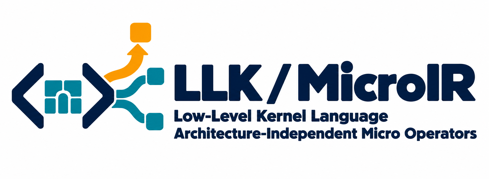

# LLK / MicroIR logo

## Meaning

- **Code brackets:** custom LLK kernel semantics and a compiler-defined dialect.
- **Small teal primitive blocks:** composable atomic micro operators are the building blocks of MicroIR execution. Their modular structure also echoes the project's Tile model.
- **Three branching routes from one core:** the same architecture-independent representation can map to different NPU architectures, target resources and implementation choices.
- **Highlighted amber route:** search selects a plan using performance evaluation and feasibility checks. The rising route suggests optimization; it does not claim measured speedups.
- **LLK / MicroIR wordmark:** places the low-level kernel language and its shared micro-operator execution IR at the center of the identity. The two explanatory lines expand this as `Low-Level Kernel Language` and `Architecture-Independent Micro Operators`.

## Asset

`llk-microir-logo-white.png` is the preferred revision: a 2069 × 760 opaque PNG with a solid white background. It preserves the original horizontal emblem and emphasizes LLK and MicroIR in the main wordmark, with consistent explanatory typography.

`dslcompiler-logo-white.png` is the earlier 2069 × 760 revision with a solid white background and the original project-name headline.

`dslcompiler-logo-v2.png` is the corresponding 2069 × 760 version with a transparent alpha background. The `LLK / MicroIR` subtitle uses a geometric sans-serif treatment consistent with the main wordmark, with matching weight and tighter, balanced spacing. The original emblem and horizontal design are retained.

`dslcompiler-logo.png` preserves the original 2070 × 760 design from commit `fd2ad03`. Both files are raster logos with geometric styling, not SVGs. The dark lettering is intended for a light background. Keep their aspect ratios and clear space; do not stretch them.

The logo was created with the built-in image-generation tool. It is saved here for project use; the root README and documentation theme have not been changed.

The typography revision was created with the built-in image-generation edit tool using the original logo as its reference. Its exact prompt is in [font-revision-prompt.txt](font-revision-prompt.txt).

The white-background revision uses the same built-in image editor; its exact prompt is in [white-background-prompt.txt](white-background-prompt.txt).

The LLK / MicroIR identity revision uses the white-background logo as its reference. Its exact built-in image edit prompt is in [llk-microir-identity-prompt.txt](llk-microir-identity-prompt.txt).

## Original generation prompt

Use case: logo-brand.
Asset type: final horizontal project logo with emblem and wordmark, for the README and documentation of the open-source DNN compiler project DSLCompiler.
Primary request: Create an original, refined, memorable geometric identity expressing custom LLK kernel semantics becoming machine-independent MicroIR, then target mapping and search-guided performance optimization.
Design: one coherent compact symbol, not a flowchart. A pair of compact code brackets encloses a small modular tile core with a subtle Greek mu / micro-inspired negative space. The brackets represent the custom LLK kernel dialect; the regular tiles represent the shared machine-independent execution IR. From this same core, three concise geometric route strokes branch toward three small, differently arranged square endpoints, suggesting different machine targets. One route is emphasized and rises decisively, representing search selecting an efficient plan and performance evaluation guiding compilation. Integrate these ideas into a strong simple silhouette with very few parts. Do not draw separate illustrations for each concept. The emblem must still feel like one logo at small size.
Typography: To the right of the emblem, render the exact project name "DSLCompiler" in a premium clean geometric sans-serif, well kerned, deep ink color. Below the name, a smaller carefully spaced technical descriptor reading exactly "LLK / MicroIR". Correct spelling and capitalization are essential: D S L C o m p i l e r; L L K; M i c r o I R. No other text.
Style/medium: flat vector-like brand design with crisp precise edges, confident weights, generous negative space, restrained sophisticated geometry. Balanced horizontal lockup, emblem height about the combined text height, useful transparent margin around the whole design. No presentation board.
Color: deep ink navy for brackets and type, cool teal for the universal tiled core and alternative routes, one restrained amber accent for the selected optimization route. Solid flat colors only.
Backdrop: genuinely transparent alpha background, not a white rectangle and not a drawn checkerboard.
Constraints: polished usable logo, not a diagram; few components; strong alignment; no captions, legends, tiny labels, benchmark numbers, gauges, stock chip pins, robot, brain, magnifying glass, gears, gradients, shadows, glow, 3D, mockups or watermark. A standalone single logo only.
