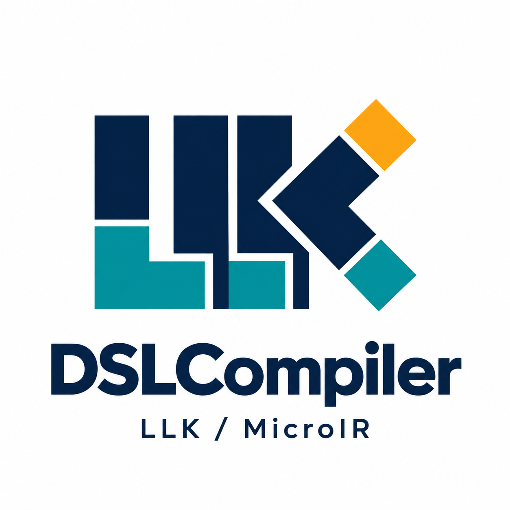
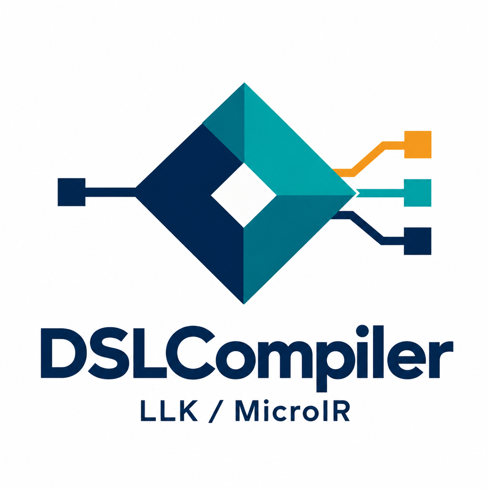
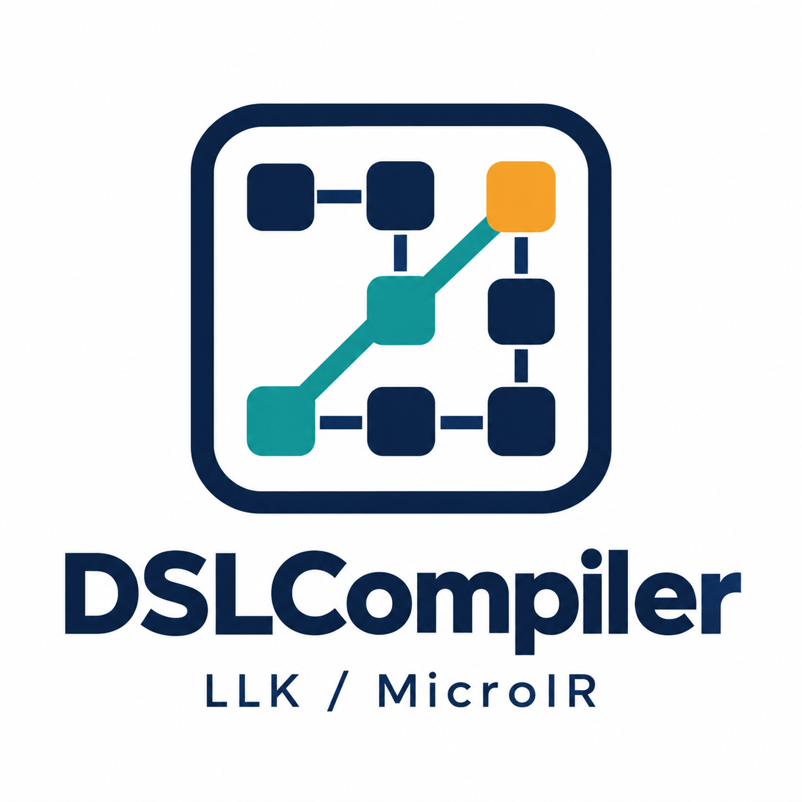
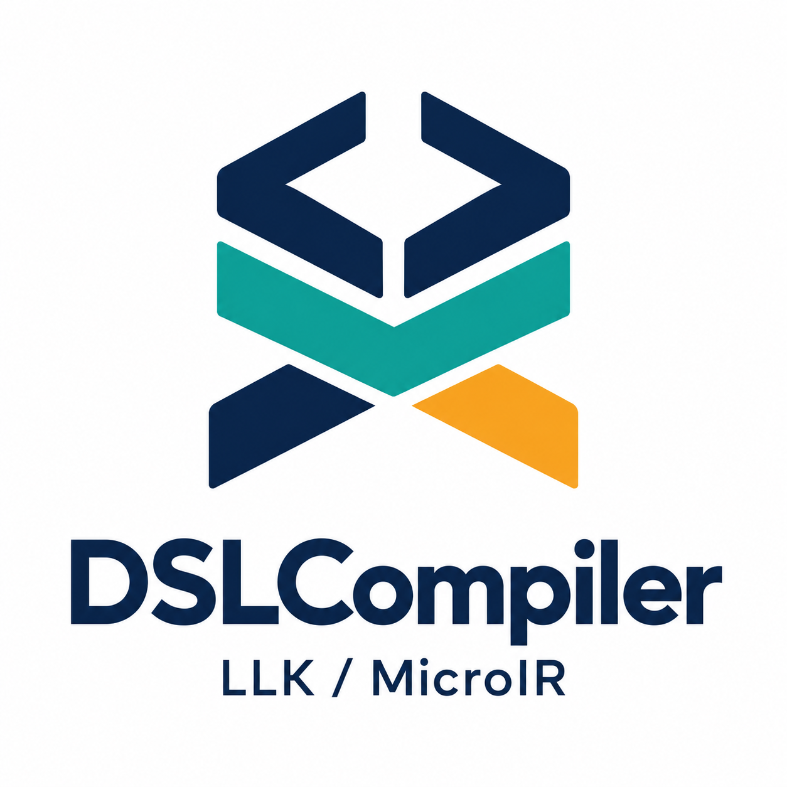

# Alternative logo directions

Four alternatives created with the built-in image-generation tool, using a shared navy / teal / amber palette and the same wordmark so the symbols can be compared. These PNG concept previews have white backgrounds.

| Option | Emphasis | Meaning |
| --- | --- | --- |
| A — LLK monogram | Kernel dialect identity | Modular LLK strokes encode kernel composition; the K branches suggest alternative mappings, with an amber selected endpoint. |
| B — MicroIR prism | Machine-independent representation | A common central core accepts one input and maps to multiple target paths; the amber branch is the selected plan. |
| C — Search lattice | Compiler optimization | Tile nodes are candidates in a legal search space; the emphasized route leads to a selected amber candidate using feasibility and performance evaluation. |
| D — Compiler layers | Framework architecture | Brackets suggest LLK semantics, a teal middle layer suggests MicroIR, and split lower legs suggest target implementations with one selected in amber. |

The highlighted paths are conceptual symbols for performance-guided search; they do not claim measured speedups. Any selected concept can be refined into a final transparent logo and icon.

## A — LLK monogram

## B — MicroIR prism

## C — Search lattice

## D — Compiler layers

## Generation

The exact final generation prompts for all four images are saved in [prompts.json](prompts.json). The original horizontal logo remains in the parent directory.
