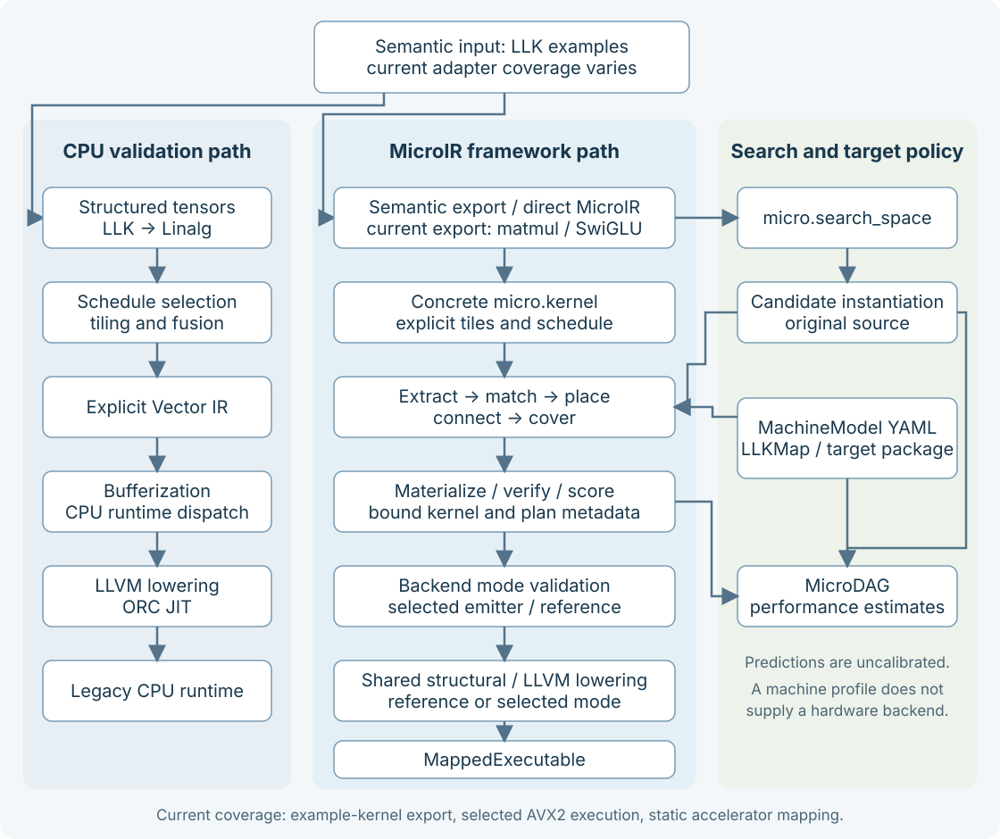

.. _architecture-architecture:

Architecture
============

The project goal is a **generic MicroIR-based, mapping- and search-based DNN
compiler framework**. Matmul and fused SwiGLU are validation examples, and AVX2
is the first executable validation backend. The reusable IR, mapping, search and
selected-plan lowering contracts define the architecture. The
:source:`framework design spec <docs/superpowers/specs/2026-10-12-generic-microir-dnn-compiler-framework-design.md>`
governs project direction; :doc:`features` describes delivered support.

The compiler separates mathematical semantics, schedule choices, machine facts,
and target implementation. It uses MLIR's existing tensor, Linalg, Vector, SCF,
memref, and LLVM infrastructure, plus a small semantic ``llk`` dialect and the
canonical execution ``micro`` dialect.

This page explains the current component boundaries. Start with
:doc:`concepts </concepts>` if tiles, owners, or search spaces are unfamiliar.
For runnable commands, use :doc:`getting started </getting-started>` and the
:doc:`tool guides </index>`.

.. _architecture-two-cpu-compilation-paths:

Framework path and CPU validation
---------------------------------

The MicroIR path is the framework center: source candidates feed mapping and
covering search, complete-plan materialization and shared feasibility/scoring,
then selected-plan lowering or analysis. Direct MicroIR input can exercise these
contracts independently of semantic export. The established LLK/Linalg CPU path
provides validation and comparison infrastructure. The two routes have distinct
operation coverage and backend policies.

   The framework path, CPU validation route, and search/target inputs. Labels describe current integration coverage.

The left path is the existing CPU validation pipeline: tensor optimizations,
explicit vectorization, bufferization, runtime dispatch, and LLVM lowering. The
middle path maps MicroIR and can execute supported kernels through selected AVX2
or portable reference lowering. Reference numerical tests establish portable
correctness; selected AVX2 tests separately establish chosen vector-width and ISA
realization within their fixture scope. See the current :doc:`feature limits </features>`.

The routes have different semantic coverage. Fused SwiGLU supports the legacy
LLK-to-Linalg conversion; ``llk.matmul`` is left untouched by that pass and uses
Micro export plus mapped compilation. RoPE and attention use the established
CPU path and are not current ``LLKToMicro`` export roots.

Target-aware search instantiates the original source, maps and analyzes candidates,
and saves selected-plan artifacts for replay. The source supplies a versioned
workload contract through a registered adapter; contraction keeps its explicit
M/N/K and dtype inputs, while the bounded elementwise family describes its own
ordered ports and axes. Compatibility mode remains synthetic. Optional verified
measurement uses the shared mapped compiler and typed inputs.

.. _architecture-generic-contracts-and-current-limits:

Generic contracts and current limits
------------------------------------

New workloads contribute semantic decomposition into supported MicroIR primitives.
New targets contribute machine profiles, layouts/rules and emitters. Shared mapping
and analysis consume operation/dataflow facts rather than operator-name switches.
The LLK exporter and contraction source family keep M/N/K, BM/BN/BK and two arms
as adapter limits rather than generic workload fields. Source realization is
dispatched through an immutable adapter registry: the adapter describes the
versioned contract (ordered ports, axes, numerical semantics and required
primitives), declares parameter ownership and reports what it realized, so a
frozen record carries the canonical contract and receipt next to the selected
plan. The delivered non-contraction family is bounded rank-two f32 add/multiply.

Typed mapped invocation still accepts rank-two buffers. That is an execution
envelope, not an analysis limit: rank-three contracts and rank-one reductions
reach static reporting and lowered IR, while executable preparation fails with an
explicit ``runtime_capability:`` diagnostic. General structured import, wider
invocation and additional non-contraction families remain capability work.

Conformance is reported per compiler stage. ``CapabilityReceipt`` records
structure, interpretation, mapping, physical plan, reference lowering, selected
lowering, ABI eligibility, preparation, host compatibility and invocation as
supported, unsupported or not checked for one
concrete source/contract/target/plan artifact. The receipt layer sits above
mapping, performance and runtime, runs no lowering or JIT to produce a static
report, and is keyed by existing complete identities. Before analysis and
scoring, ``verifyTargetOperationCoverage`` groups the bound IR by selected
instance and asks each emitter to validate its covered variant and types, so an
unsupported operation is a candidate rejection rather than a late backend error.
Target policy remains declarative: generic mapping/machine code never branches on
a target name, and a boundary scan enforces that these libraries do not acquire
performance, runtime or JIT links.

Framework validation covers tile semantics, non-contraction computation, fusion,
movement/layout, resource capacity, search/replay, analysis parity, composed
vector/reduction behavior and extension portability. Matmul/SwiGLU tests prove
only the contracts and fixtures they exercise. The
:source:`framework conformance review <docs/reviews/2026-10-12-framework-conformance.md>`
records the current capability matrix. The
:source:`operator registration proposal <docs/superpowers/specs/2026-10-11-conversion-kernel-lowering-framework-design.md>`
and merged :source:`MicroDAG event-builder seam <docs/superpowers/specs/2026-10-04-micro-dag-ioc-design.md>`
advance extensibility without establishing arbitrary DNN coverage.

.. _architecture-components-and-ownership:

Components and ownership
------------------------

.. list-table::
   :header-rows: 1
   :class: wide-table

   * - Component
     - Responsibility
     - Start reading here
   * - LLK dialect
     - Domain operations, assumptions and specialization metadata
     - :source:`LLKOps.td <include/LLK/Dialect/LLKOps.td>`, :source:`LLKOps.cpp <lib/Dialect/LLK/LLKOps.cpp>`
   * - Micro dialect
     - Tile types, canonical execution/search operations, structural verification
     - :source:`MicroOps.td <include/LLK/Dialect/Micro/MicroOps.td>`, :source:`MicroOps.cpp <lib/Dialect/Micro/MicroOps.cpp>`
   * - LLK conversions
     - Semantic-to-Linalg lowering and supported Micro export
     - :source:`LLKToLinalg.cpp <lib/Conversion/LLKToLinalg/LLKToLinalg.cpp>`, :source:`LLKToMicro.cpp <lib/Conversion/LLKToMicro/LLKToMicro.cpp>`
   * - Workload contracts and source adapters
     - Rank-neutral port/axis contract, adapter registry, contraction compatibility wrapper, bounded elementwise family and binding receipts
     - :source:`WorkloadContract.h <include/LLK/Conversion/Workload/WorkloadContract.h>`, :source:`SourceAdapter.h <include/LLK/Conversion/Workload/SourceAdapter.h>`, :source:`implementation <lib/Conversion/Workload>`
   * - CPU transforms
     - Scheduling, tiling, fusion, vectorization, packing and dispatch
     - :source:`transforms <lib/Transforms>`, :source:`schedule loader <lib/Transforms/Common/ScheduleLoader.cpp>`
   * - ``LLKMachine``
     - Topology, validation, queries and model hash
     - :source:`MachineModel.h <include/LLK/Machine/MachineModel.h>`, :source:`loader <lib/Machine/MachineModelLoader.cpp>`
   * - ``LLKMapping``
     - Workload graph, declarative matching, placement, routing, search, plan data and verification
     - :source:`mapping interfaces <include/LLK/Mapping>`, :source:`mapping implementation <lib/Mapping>`
   * - ``LLKTargetMapping``
     - Target factories, policy files and emitter behavior
     - :source:`target packages <lib/Target>`, :source:`mapping policy <mapping>`
   * - ``LLKMicroMapping``
     - MLIR pass adapters and canonical plan materialization
     - :source:`MicroMapping <lib/Conversion/MicroMapping>`
   * - ``LLKPerf``
     - Search candidate analysis, MicroDAG, model estimates and tuning core
     - :source:`performance interfaces <include/LLK/Perf>`, :source:`implementation <lib/Perf>`
   * - ``LLKMappedCompilation``
     - Bind, verify, target-lower, lower to executable form
     - :source:`MappedCompilation.cpp <lib/Conversion/MicroMapping/MappedCompilation.cpp>`
   * - Runtime
     - JIT lifetime, descriptor invocation, cache, packed weights and thread pool
     - :source:`runtime <runtime>`, :source:`MappedExecutable.h <include/LLK/Runtime/MappedExecutable.h>`

Root :source:`CMakeLists.txt <CMakeLists.txt>` orchestrates the build.
Shared setup lives in :source:`cmake/ <cmake>`; library definitions live beside
their sources, tools in :source:`tools/CMakeLists.txt <tools/CMakeLists.txt>`,
and test registrations in :source:`test/ <test/CMakeLists.txt>`.
The tools are integration drivers: :doc:`compiler </tools/compiler>`,
:doc:`optimizer </tools/optimizer>`, :doc:`performance analyzer </tools/performance>`,
:doc:`tuner </tools/tuning>`, and :doc:`benchmark </tools/benchmark>`.

.. _architecture-mapping-from-a-kernel-to-a-selected-plan:

Mapping from a kernel to a selected plan
----------------------------------------

Mapping consumes a concrete kernel plus a target. The phases have explicit data
models so a contributor can inspect one decision at a time:

.. list-table::
   :header-rows: 1
   :class: wide-table

   * - Phase
     - Input → output
     - Decision made
   * - Extract
     - ``micro.kernel`` → ``WorkloadGraph``
     - Nodes, value edges, boundary ports and source associations
   * - Match
     - Graph + rules → ``MappingCandidate``
     - Which single operation or bounded fused group a rule covers
   * - Place
     - Candidate + topology/layouts → ``CandidateInstance``
     - Executor, compute, memory and solved layout choices
   * - Connect
     - Producer/consumer instances → connection alternatives
     - Direct use, routes, transforms or combined movement
   * - Cover
     - Instances/connections → ``CoveringPlan``
     - A coherent selection covering the workload
   * - Bind
     - Source + plan → cloned mapped module
     - Persist selections and materialize required movement/sync
   * - Verify
     - Mapped module + target → diagnostics
     - Structure, referenced facts and selected semantic consistency

The main interfaces are :source:`WorkloadGraph.h <include/LLK/Mapping/WorkloadGraph.h>`,
:source:`MappingRules.h <include/LLK/Mapping/MappingRules.h>`,
:source:`Placement.h <include/LLK/Mapping/Placement.h>`,
:source:`CoveringSearch.h <include/LLK/Mapping/CoveringSearch.h>`, and
:source:`PlanBinder.h <include/LLK/Mapping/PlanBinder.h>`.

Search supports deterministic, beam, and exact modes with configurable bounds.
Beam search is an exploration heuristic. Exact search explores its bounded
candidate/connection space. Complete-plan materialization, storage feasibility and
shared final cost evaluation occur before top-K retention. Exact mode still has
explicit finite caps; its name does not imply unbounded global optimality.

The binder clones the source instead of modifying it in place. It stores
``micro.plan``, per-operation ``micro.mapping``, and ``micro.routes``, then delegates
canonical movement construction to a materializer. Copies can carry value and
destination-node provenance. A partial binding records unmaterialized decisions;
the executable contract rejects those decisions. Concrete resource selections,
per-hop storage IDs, lifetimes and target-content identity survive binding/replay.

.. _architecture-machine-facts-and-target-policy:

Machine facts and target policy
-------------------------------

MachineModel v2 is a topology of executor, memory, compute, and transfer nodes.
Containment and dominance describe hierarchy/visibility; attachment places
capabilities at executors; directed links describe legal memory movement.
Concrete node IDs distinguish two same-kind resources. Profiles can also declare
owner refinements, coordinates, concurrency, and explicit executor equivalence.

LLKMap supplies target policy:

* **Layouts** declare finite parameter domains, constraints, canonical-kind
  bridges, and optional affine logical-to-physical maps.

* **Rules** match operation/port facts, require capabilities and layouts, declare
  boundary ports, and select opaque bundles and emitter keys.

* **Bundles and emitters** belong to the target. Generic code may persist and
  compare them but must not interpret their spelling as target behavior.

The shipped packages are :source:`x86-avx2 <mapping/x86-avx2>` and
:source:`generic-ai-accel <mapping/generic-ai-accel>`, with corresponding
:source:`machine profiles <machines>`. The generic accelerator demonstrates mapping
onto an accelerator-shaped topology; it does not execute accelerator hardware.
See the :source:`formal LLKMap syntax <docs/design/llkmap-syntax.md>` and its
:source:`EBNF <docs/design/llkmap.ebnf>` when authoring policy.

.. _architecture-library-boundaries-to-preserve:

Library boundaries to preserve
------------------------------

``LLKMachine`` supplies data and queries. ``LLKMapping`` builds generic mapping
decisions above it. ``LLKPerf`` consumes mapping cost/event primitives, so the
dependency direction is ``LLKPerf → LLKMapping``, not the reverse. JIT and runtime
dependencies belong in the compilation/integration layer. A new analysis feature
must not make the generic mapping library depend on the performance analyzer or
runtime.

Generic :source:`lib/Mapping <lib/Mapping>` and :source:`lib/Machine <lib/Machine>` must not
branch on a target name. New target policy belongs in YAML, LLKMap, or a
:source:`target package <lib/Target>`. Canonical ODS also remains free of backend owner
vocabulary: an owner/map symbol is resolved through a profile, and concrete IDs
belong in selected metadata.

.. _architecture-performance-and-execution-boundaries:

Performance and execution boundaries
------------------------------------

The performance analyzer turns concrete operations and structural scopes into a
MicroDAG, work/byte estimates, dependencies and resource events. Level 0 supplies
static bounds; level 1 adds resource scheduling. Mapping also uses cost events
and a scheduler to compare plans. Complete-plan integration uses shared normalized
materialized analysis, per-engine capacity and live-storage accounting; public
chains compare cycles and traffic and reject capacity violations.

Mapped compilation runs plan binding, mapped verification, target emitter
lowering, then ``MicroToLinalg`` and backend passes. It offers intermediate stopping
points for inspecting mapped MicroIR and target-lowered/lowered forms.
``MappedExecutable`` owns an ORC JIT and invokes a wrapper with typed rank-two
buffers. The selected backend preserves explicit vector widths and fused groups,
checks target ISA compatibility and refuses reference fallback. The reference
backend provides portable correctness. Both use checked invocation and per-call
scratch ownership. Backend conversion registers MLIR dialect interfaces and uses
the unified LLVM conversion pipeline after structural/vector lowering.

The :source:`PR #133 acceptance matrix <docs/reviews/issue67-final-acceptance.md>`
records selected x86_64 AVX2 execution, static parity and retained legacy skips.
Production measurement persistence and calibrated prediction remain #51/#52.

For the established CPU pipeline's detailed scheduling and runtime design, see
:source:`historical CPU architecture <docs/design/legacy-cpu-architecture.md>`.
For the current framework architecture, see :source:`ARCHITECTURE.md <ARCHITECTURE.md>`.
For the normative mapping design, see
:source:`the September 18 specification <docs/superpowers/specs/2026-09-18-microir-inspired-dslcompiler-enhancement-design.md>`.
Those documents include design goals and historical status; use
:doc:`features </features>` for the current community-facing capability summary.
