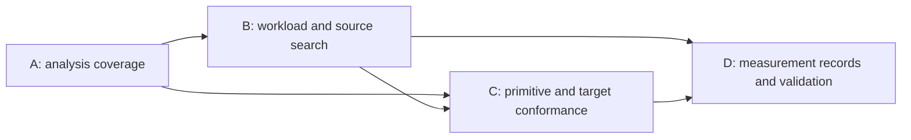

# Generic MicroIR DNN Compiler Framework Implementation Plan

> **For agentic workers:** REQUIRED SUB-SKILL: Use superpowers:subagent-driven-development (recommended) or superpowers:executing-plans to implement this plan task-by-task. Steps use checkbox (`- [ ]`) syntax for tracking.

**Goal:** Turn the existing MicroIR/mapping foundation into an extensible compilation framework whose workload and search interfaces support a verified non-contraction workload without treating matmul or SwiGLU as the framework contract.

**Architecture:** Retain canonical MicroIR, the generic workload graph, declarative targets, complete-plan evaluation and frozen replay. Add explicit analysis coverage, a separate workload-adapter/source-candidate boundary, and capability conformance; use the existing verified measurement hooks for persistent records and prediction validation. Deliver these as four independently reviewable increments.

**Tech Stack:** C++20, LLVM/MLIR, CMake/Ninja, GTest, FileCheck, Python CLI regressions, YAML machine profiles, LLKMap, JSON records and Sphinx documentation.

**Spec:** [Generic framework goal and design](../specs/2026-10-12-generic-microir-dnn-compiler-framework-design.md).

## Global Constraints

- “Design a generic MicroIR-based, mapping- and search-based DNN compiler framework.”
- “Matmul and fused SwiGLU are two example operator kernels used to test MicroIR and the compilation framework.”
- “The canonical tile contract remains `Tile = (shape, dtype, layout, memory_space, owner)`.”
- “`LLKMapping` remains independent of performance, runtime and JIT libraries.”
- “Generic machine and mapping libraries must not branch on target names or interpret opaque emitter/bundle names as policy.”
- “Numerical approximation stays explicit in semantics.”
- “Shared complete-plan materialization, live-storage/capacity checks and static analysis run before top-K retention.”
- “Rejected candidates carry reasons; missing measurement values never rank as zero.”
- “Measured and predicted metrics remain distinct.”
- All implementation writes use an isolated worktree under `.claude/worktrees/`; follow [repository policy](../../../.claude/rules/worktree-isolation.md).
- Retain existing LLVM/MLIR build compatibility. PR #143 is a separate build-policy proposal, not a prerequisite or permission to change this plan's algorithms.

## Review Focus

1. An unknown pure computation must not acquire zero cost merely because it has no memory effects: A1–A3 test scalar arithmetic and unknown leaves.
2. A non-contraction or multi-result source must not be replaced by synthetic GEMM or lose operand/result semantics: B2–B5 test exact source selection, ports, source preservation and rejected unsupported structures.
3. A parameter offered to search must change an identified source or mapping decision: B3/B6 test unused, ambiguous and unrealized bindings, deterministic domains and replay.
4. A cheap incomplete/infeasible candidate must not displace a feasible complete plan, and an analysis-only target must not claim execution: A4/C1–C4 test rejection before retention, resource parity and explicit backend capability.
5. A stored measurement must not survive an identity/environment change or enter ranking without numerical verification: D1–D4 test corrupt/stale records, missing metrics and held-out validation.

---

## 1. Revision-pinned code assessment

Source audit: **2026-10-12**, `origin/main` = `fb99595689b894fa855a68482142cf5e7f413c81`. Documentation refinement base = `634b8d06ba28c8baa576f591fa79c3d88cd2848b`, draft [PR #144](https://github.com/skg7on/DSLCompiler/pull/144). Re-audit these seams after rebasing; line numbers can move.

This is an implementation proposal. New APIs and tests in the child plans are explicitly proposed; they are not delivered support or tests already executed.

| Area | Actual code at the audited revision | Consequence for implementation |
|---|---|---|
| Canonical IR | `include/LLK/Dialect/Micro/{MicroOps.td,MicroTypes.td,MicroEnums.h}`, `lib/Dialect/Micro/MicroOps.cpp` | Keep the one-dialect tile model; reuse vector/reduce/movement/transform primitives before adding ops. |
| Semantic export | `lib/Conversion/LLKToMicro/LLKToMicro.cpp::inferRootInfo` recognizes `llk.fused_swiglu`, `llk.matmul`, `linalg.matmul`; `buildKernel` builds a contraction nest | Do not turn this nest into the generic workload driver. Retain it as a contraction adapter. |
| Candidate contract | `include/LLK/Perf/SearchSpace.h::WorkloadShape` is M/N/K plus four dtype fields; `Legality.h::BindingFacts` is original shape plus contraction shapes | Add generic source facts alongside these compatibility helpers. Existing shape-independent constraints already work without contraction facts. |
| Source instantiation | `lib/Conversion/MicroMapping/CandidateInstantiation.cpp:210`: semantic mode binds BM/BN/BK; concrete mode rejects all params and requires `original_workload` and at least one contraction | A directly authored elementwise kernel cannot use the current mapped-tuning entry contract. Add a descriptor-based overload and explicit adapter selection. |
| Search representation | `SearchSpace`, `SearchParam`, `Candidate` already hold arbitrary parameter names, kinds, roles, finite choices and stable IDs | Preserve these mechanisms. Add binding ownership/realization accounting, not a second candidate generator. |
| Mapping graph | `include/LLK/Mapping/WorkloadGraph.h`, `lib/Mapping/WorkloadGraph.cpp` represent primitive SSA dataflow | This is already the generic mapping artifact; do not replace it with a new operator catalog. |
| Mapping search | `CoveringSearch`, `MappingSearchOptions::evaluateCompletePlan`, `requireCompleteEvaluation`, resource/storage/route models | PR #133 delivered feasibility-before-retention and original-source mapped tuning. Keep and regression-test them. |
| Shared analysis | `SelectedKernelAnalysis::{complete,incompleteReasons}`, `analyzeSelectedKernel`, normalized events and plan storage liveness | Completeness exists for dynamic/unsizable facts. Extend it to interpretation coverage rather than adding a competing analysis. |
| Interpretation injection | PR #141 merged at this base; `OpDAGBuilderRegistry`, `makeDefaultOpDAGBuilders`, `MicroDAG.cpp::DAGBuilder::buildOp` | Registry/traversal separation is already implemented. The unregistered-leaf success path still silently contributes no events. |
| Selected lowering | `lib/Target/X86/Mapping/{AVX2BundleLowering,AVX2BackendLowering}.cpp`, `lib/Conversion/MicroToLinalg/MicroToLinalg.cpp` | Reuse selected vector add/mul/reduce and portable reference paths with explicit capability checks. No silent fallback. |
| Runtime | `KernelAbi.h`, `MappedInvocation.h`, `runtime/MappedInvocation.cpp`: ABI v1, rank-two compact row-major, offset zero, disjoint outputs, at most 12 descriptors | First executable non-contraction fixture stays within this ABI. Rank-neutral contracts do not imply rank-neutral execution. |
| Measurement | `MappedTuningSession.h` supplies full canonical identity, input/provider/verifier callbacks; `tools/llk-tune/llk-tune.cpp` already times warmup/repeat runs and emits identity | Do not implement another measurement loop. Extract reusable record/protocol code, persist verified results and report prediction error. |
| Optional latency | `include/LLK/Mapping/LatencyProvider.h`: operation key version 3, connection key version 3, target content hashes; optional hits | Kernel timing cannot be distributed to event keys without attribution evidence. Keep whole-kernel records separate from event overrides. |

### Pending neighboring work

- [PR #142](https://github.com/skg7on/DSLCompiler/pull/142), inspected at `e03b7cb13e36d964ea123b1403d93b5b30764ec0`, introduces `include/LLK/Conversion/LLKKernel/LLKKernelLowering.h` and per-operator lowerings. Its `KernelContract` still has M/N/K; `MicroKernelFragment` has contraction arms/RHS/epilogue. It is useful for the legacy adapter, but does not supply B1's generic contract. B4 supports either merged registry or the current exporter; do not copy the pending implementation into this branch.
- [PR #143](https://github.com/skg7on/DSLCompiler/pull/143) proposes shared LLVM/MLIR and CMake simplification. Source registrations below are in root `CMakeLists.txt`, because there is currently no `lib/Perf/CMakeLists.txt` or `lib/Conversion/MicroMapping/CMakeLists.txt`. Preserve the prevailing link helper after any merge.
- [Issue #51](https://github.com/skg7on/DSLCompiler/issues/51) and [issue #52](https://github.com/skg7on/DSLCompiler/issues/52) remain open. Their measurement/calibration-record work overlaps D. #52 explicitly excludes automatic fitting; this plan includes record persistence and validation, with fitting a later design increment.

### Evidence boundary

The source audit used the codebase knowledge graph and inspected current headers, implementations, fixtures and registrations. Existing local `build/bin/LLKPerfTests` returned **zero** matches for `OpDAGBuilders.*`; those artifacts cannot establish a baseline for #141. No fresh full compiler build or new implementation tests were run while writing this plan. Historical PR #133 evidence remains [revision-pinned](../../reviews/issue67-final-acceptance.md), not evidence for future tasks.

## 2. Delivery sequence and dependency graph



| Increment | Detailed plan | Tasks | Independently reviewable exit |
|---|---|---|---|
| A | [Explicit interpretation coverage](2026-10-12-microir-analysis-coverage.md) | A1–A4 | Unknown leaves are classified; strict analysis/search rejects partial coverage while legacy custom builders remain usable. |
| B | [Workload contracts and source search](2026-10-12-microir-workload-source-search.md) | B1–B7 | Direct non-MMA tuning and a static rank-two Linalg elementwise adapter work through original-source search/mapping/replay; contraction examples retain behavior. |
| C | [Primitive and target conformance](2026-10-12-microir-framework-conformance.md) | C1–C4 | Capability reports and a mixed primitive/topology suite distinguish analysis, reference and selected execution, with shared resource/traffic/storage evidence. |
| D | [Verified measurement persistence and validation](2026-10-12-microir-measurement-validation.md) | D1–D4 | Versioned verified records survive process restarts; identity misses stay misses; held-out reports quantify prediction error without changing default static costs. |

**Recommended first implementation PR:** A only. It is small, closes a correctness hole in the generic analysis contract, and establishes the completeness gate B/C depend on. Implement B as a second PR; C and D are separate reviews. No operator throughput target is a release gate for these increments.

Each child plan supplies file ownership, proposed interfaces, executable test examples, red/green commands, commits and acceptance. Execute tasks in order within an increment. Finish the increment's checks before starting its dependent increment.

## 3. Execution preparation and fresh baseline

- [ ] Read `CLAUDE.md`, the framework spec, this index and the selected child plan. Inspect `git status --short` and existing attached worktrees before making an implementation worktree. Keep documentation and implementation PRs separate.
- [ ] Fetch main and record the exact implementation base; inspect whether #142/#143 merged. Reconcile only moved paths/API seams. Record any semantic departure in the implementation PR before coding.

```bash
git fetch origin
git rev-parse origin/main
git status --short
git worktree list
```

- [ ] Create an implementation worktree under `.claude/worktrees/`, for example branch `feat/microir-analysis-coverage` for A. Do not reuse the docs branch for compiler implementation.
- [ ] Configure a fresh build in that worktree using an installed matching LLVM/MLIR build. The repository's documented local path is shown below; another executor must substitute its actual installation, and CI must retain its pinned toolchain.

```bash
cmake -S . -B build -G Ninja \
  -DLLVM_PROJECT_BUILD_DIR=/Users/skg7on/Workspace/Projects/llvm-project/build \
  -DLLK_BUILD_E2E_TESTS=ON
cmake --build build --target check-llk -j 6
build/bin/LLKPerfTests --gtest_list_tests
ctest --test-dir build -N
```

Expected: all baseline registered tests complete with zero failures; the fresh test list includes `OpDAGBuilders`. Record actual skip/disabled counts and host ISA. A binary reporting zero selected tests is a failure of the evidence gate. If a baseline failure exists, identify whether it reproduces before the task; do not relabel it as expected task red.

## 4. Scope boundaries and design decisions

1. **Generic does not mean unbounded import.** B introduces a rank-neutral static port/dataflow contract, then one bounded `linalg.generic` elementwise adapter. Arbitrary Linalg bodies, broadcasting, dynamic shapes, reductions imported from Linalg, model import and global graph scheduling are explicitly rejected or deferred. C tests existing directly authored reductions independently.
2. **Contraction support remains specialized.** BM/BN/BK, fragments, accumulator/init semantics and SwiGLU multi-arm export are handled by the contraction adapter. The old `WorkloadShape` overload forwards to it. No source-independent binder enters the new generic path.
3. **Search remains staged.** Source bindings alter source-derived MicroIR; mapping bindings restrict LLKMap search. Every offered binding must be consumed exactly once at a declared boundary. Fusion/reordering beyond the first elementwise body require subsequent transformation descriptors and numerical/effect proofs.
4. **No new dialect is required.** Add attributes/contracts only where existing ops lack provenance or binding information. The first elementwise adapter emits existing tile views/copies/vector/loop/yield ops. It must not add `micro.elementwise_add` or an operator-name switch to generic mapping.
5. **Rank-neutral description precedes wider execution.** B1 accepts static rank-one/rank-three shapes for contract/analysis purposes; B7/C1 prove executable requests outside ABI v1 fail explicitly. A separate ABI-v2 design is required only when a supported executable workload needs it. That design must define rank/strides/offsets/alias/effect rules, calling convention, migration and identity; this plan does not silently flatten tensors or raise the 12-descriptor cap.
6. **Target portability is conformance, not invented hardware.** C uses AVX2 plus the existing generic accelerator and synthetic topology variants. No new physical accelerator backend is claimed. A later hardware package needs emitter/backend and on-device evidence under the same contracts.
7. **Coverage and accuracy are separate.** `complete` means every required semantic/resource fact has a supported interpretation. It does not mean cycle-accurate prediction. D reports measured error and preserves model origin.
8. **Whole-kernel measurements stay whole-kernel.** Persistence in D can inform candidate ranking/replay. Feeding operation/connection `LatencyProvider` entries requires isolated measurements with matching event signatures; aggregate kernel time is not divided by event count.

## 5. Framework acceptance crosswalk

| Spec acceptance row | Existing foundation retained | New evidence |
|---|---|---|
| Tile/dataflow | Dialect verifier, dependency extraction | A2 zero-cost classification; B5 emitted tile/SSA verification; C2 movement/layout. |
| Contraction | Matmul tails/init/dtypes and selected execution | B4/B7 old-vs-new adapter regression. |
| Multi-branch fusion | SwiGLU shared inputs/accumulators/fused epilogue | B4/B7 preserves source and selected group evidence. |
| Non-contraction | Existing direct vector/reduce ops | B2 direct MicroIR; B5 structured add/mul; B6 varied tile choices; C3 direct reduction. |
| Movement/layout | Route/materialization/per-hop storage | C2 route and transform fixtures with literal expected traffic/identity. |
| Resource feasibility | Complete evaluation before top-K | A4 unknown-coverage rejection; C2 constrained-memory and same-kind-engine cases. |
| Search/replay | Stable bindings and frozen plans | B3 realization accounting; B6/B7 source/contract identity and finite-domain replay. |
| Analysis | Shared selected/materialized analysis | A3/A4 completeness; C2/C3 events, cycles, traffic, capacity parity. |
| Target extension | AVX2 + generic accelerator | C1 capability records; C4 renamed profile/changed topology uses declarative policy. |
| Semantic extension | Current contraction exporter | B5 adds a structured non-contraction input without generic planner changes. |
| Backend execution | Separate selected/reference execution | B7 numerical tests; C3 selected implementation evidence; C1/C4 unavailable backend rejection. |
| Feedback | Provider/verifier/identity hooks | D1–D4 persistence, protocol metadata, stale-record refusal and held-out prediction validation. |

Future broad model import, arbitrary-rank runtime, general source fusion/reordering, automatic fitting and new hardware backends require new bounded designs. The acceptance table above must report these as unsupported, not omit their limits.

## 6. Integration and release gates

- [ ] Run each task's targeted red/green cycle in the fresh worktree build, checking nonzero test counts. Run the full registered suite once per completed increment, then repeat only after fixes or additional changes.

```bash
cmake --build build --target check-llk -j 6
git diff --check
```

- [ ] On supported x86 hardware, run required-selected AVX2 acceptance and record zero selected-path skips, realized groups, vector widths and numerical results. On another host, record the host limitation and require the selected CI job before acceptance; portable success cannot replace selected execution.
- [ ] Update `docs/manual/source/features.rst`, `architecture.rst`, the relevant tool pages and `docs/design/micro-ir-mapping-workflow.md` in the increment that ships support. Use the contract matrix, source revision and measured/predicted origin, rather than a new operator-count milestone.
- [ ] Build the manual strictly and run its example/reference checks. Do not run not-yet-implemented plan snippets as current documentation examples.

```bash
build/docs-venv/bin/python -m sphinx -b html -n -W --keep-going \
  -d build/docs/doctrees docs/manual/source build/docs/html
```

- [ ] Commit per task, push the implementation branch and open a PR for the completed increment. The PR description states the changed behavior, supported input/target/ABI bounds, exact tested revision/commands and remaining gaps. Attach it to the implementation chat. Preserve historical #133/#141 evidence.

## 7. Plan self-review

The four child plans cover spec §§3–5's artifact, extension and search contracts and §7's acceptance matrix. Spec §6's broader runtime/frontend/hardware scope is represented by explicit capability rejection and the bounded future-design gates in §4 above. The new contracts below do not claim complete DNN-model import, arbitrary source transformations or hardware execution for every topology. Review-focus cases are assigned to named tasks; proposed APIs are distinguished from current APIs, and all source registrations use the audited root CMake structure.
